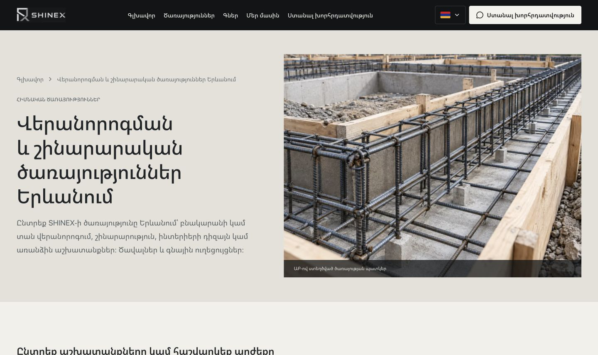
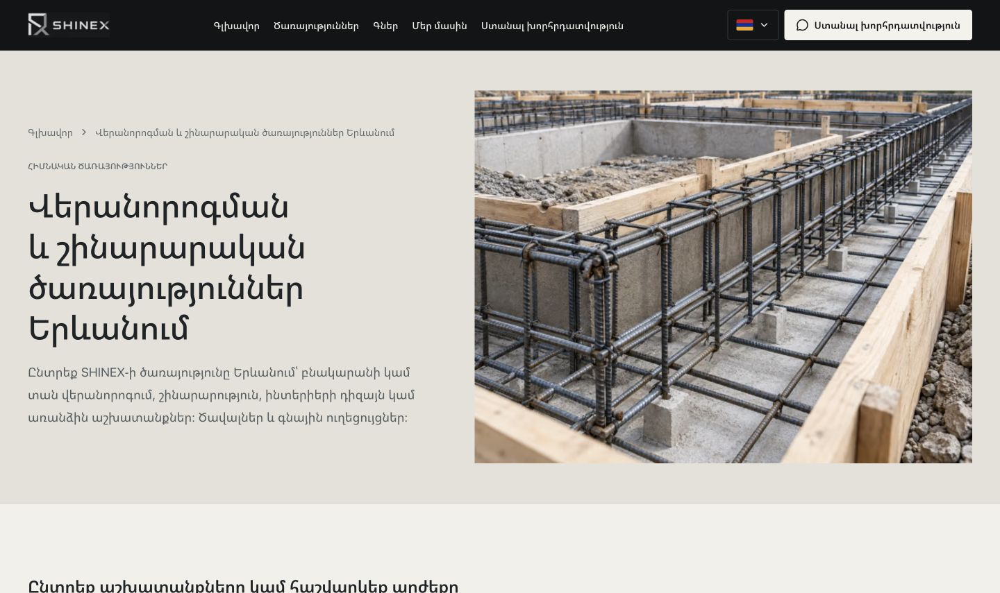
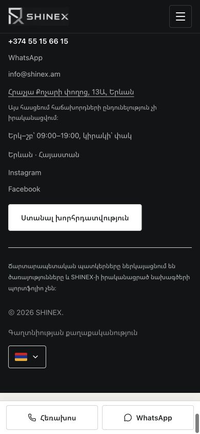

# Очистка изображений SHINEX — 10 ноября 2026

Предыдущий редизайн сохранён. Технические подписи удалены из JSX, а не скрыты стилями. Изображения, пути, alt-тексты, содержательные подписи строительных этапов и названия услуг сохранены.

## Аудит и результат

Проверены 169 файлов исходного кода: React-компоненты, конфигурации, локализации, стили, данные и вспомогательные модули. Все найденные подписи о генерации были HTML-текстом. CSS-псевдоэлементы содержат только пустые декоративные строки; надписей через `content` нет.

Удалено **285 экземпляров технических подписей** из HTML 120 индексируемых страниц на пяти языках (hy, ru, en, fr, de), по 57 на язык. Число учитывает также изображения в переключаемом блоке услуг: не все подписи были видны одновременно.

| Компонент | Удалено на пяти языках |
| --- | ---: |
| Hero | 5 |
| WorkProcess | 5 |
| WhyUs | 5 |
| SpecializedServices | 15 |
| ServiceCard, галерейный вариант | 20 |
| PageHero, каталог и компания | 10 |
| ServiceHero | 80 |
| ServiceDetails | 80 |
| ServiceProcessGallery, только техническая строка | 65 |
| **Всего** | **285** |

Очищён также обычный вариант ServiceCard, который сейчас не добавляет экземпляров к этому подсчёту. Всего удалено десять мест вывода в JSX. Удалены связанные стили, опциональные поля caption и повторяемые технические строки из конфигураций. У заголовков галерейных карточек убран нижний отступ, резервировавшийся под подпись. Размеры фотографий, адаптивная сетка и правила hover остались прежними.

В Footer добавлено одно локализованное пояснение на страницу: архитектурные изображения иллюстрируют услуги и не являются портфолио выполненных проектов SHINEX. Оно находится вне фотографий. Данные `generated` / `generated-concept` и документы о происхождении ранее созданных изображений сохранены. Разделы неподтверждённых проектов по-прежнему не опубликованы.

## Файлы изображений и права

- Визуально просмотрены **48 локальных WebP**, включая восемь мобильных вариантов: видимых встроенных технических надписей и водяных знаков не обнаружено. Контактные листы: `asset-sheet-1.jpg` … `asset-sheet-6.jpg`.
- Проверены три PNG с фирменной графикой/декорацией и исходники пяти SVG. Логотипы SHINEX сохранены; неиспользуемые файлы шаблона не менялись.
- Проверена загрузка семи существующих фотографий Unsplash в каталоге и их отображение на полном снимке (`catalog-audit-sheet.jpg`). Надписей о генерации нет. Логотип на одежде архитектора в исходной фотографии не является техническим overlay и оставлен без изменений. Внешние фотографии, ссылки и существующая атрибуция не редактировались.
- **Обработано для сайта: 0 файлов. Заменено чистыми оригиналами: 0 файлов.** Ретушь и inpainting не понадобились. Не осталось обнаруженных водяных знаков генераторов, удаление которых пришлось бы откладывать из-за лицензии или риска дефектов.
- Все **56 файлов public**, включённых в инвентаризацию, совпадают с исходными SHA-256. Следовательно, геометрия, форматы, размеры, встроенные метаданные и возможные маркеры происхождения не изменены.

Использованы rg/Node.js для поиска и сравнения, Sharp только для обзорных листов и проверки размеров, браузер Codex для визуального аудита и Next.js/ESLint/TypeScript для проверок. Новые зависимости не устанавливались; генерация изображений, OpenCV и LaMa не применялись.

## Проверки

- `npm run build` — успешно, 138 статически подготовленных страниц и служебных маршрутов.
- `npm run lint`, `npm run typecheck`, `git diff --check` — успешно.
- `npm run seo:check`, `npm run calculator:check`, `npm run leads:check`, `npm run analytics:check` — успешно. Живые сообщения не отправлялись.
- Сравнение production HTML до/после для **120 URL**: title, description, H1, canonical, hreflang, robots, JSON-LD, внутренние ссылки, основной SEO-контент и защищённые исходники без изменений (`seo-comparison.json`).
- HTTP-обход: 120 страниц, 50 вариантов снятых URL, корневой редирект, пять редиректов со слешем, 30 настоящих 404 — успешно (`http-seo-check.json`). Проверка также подтверждает наличие пояснения об иллюстрациях во всех локализациях.
- Браузер: 120 маршрутов × две ширины, **390 и 1440 px**. Осталось технических подписей: **0**. Пустых figcaption: **0**. Горизонтальных переполнений и отмеченных проверкой проблем с переносами: **0** (`dom-after.json`, `typography-after.json`).
- Сравнение DOM подтверждает сохранение src, alt, sizes, loading, названий услуг и содержательных подписей галереи (`comparison.json`).
- Выполнены 16 снимков до и 16 после: главная, каталог, дома, монолит, квартиры, коммерческие услуги, компания, цены — desktop/mobile. Для финальных снимков дополнительно проверена загрузка hero-изображений (`screenshot-image-loading.json`).
- Старые SEO-проверки обязательных подписей над каждой фотографией заменены проверкой сохранённого происхождения ассетов и общего пояснения. Остальные SEO-проверки сохранены.

Размер всех выдаваемых статических JS/CSS в gzip: 406593 → 406298 байт; суммарный HTML 120 страниц: 15535521 → 15530668 байт. Изображения и зависимости не выросли. Это сравнение сборок, не измерение Core Web Vitals (`size-comparison.json`).

## Изменённые файлы этой задачи

Компоненты:

- `components/sections/hero.tsx`
- `components/sections/work-process.tsx`
- `components/sections/why-us.tsx`
- `components/sections/specialized-services.tsx`
- `components/ui/service-card.tsx`
- `components/ui/page-hero.tsx`
- `components/ui/architectural-image.tsx`
- `components/services/service-page.tsx`
- `components/layout/footer.tsx`

Стили:

- `components/sections/editorial.module.css`
- `components/services/service-page.module.css`
- `components/layout/premium-layout.css`

Конфигурации и проверки:

- `config/hero-media.config.ts`
- `config/service-media.config.ts`
- `config/image-disclosure.config.ts` — новый файл с пояснением на пяти языках.
- `scripts/seo-check.mjs`
- `scripts/lib/crawl-seo.mjs`
- `docs/image-cleanup/` — отчёт, снимки и результаты аудита.

## Пример: каталог услуг

До:

После:

Пояснение внизу сайта:

