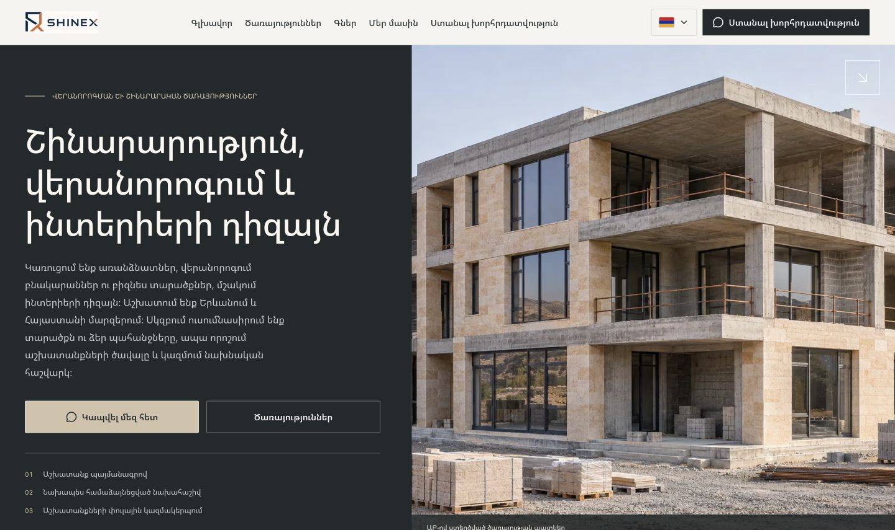
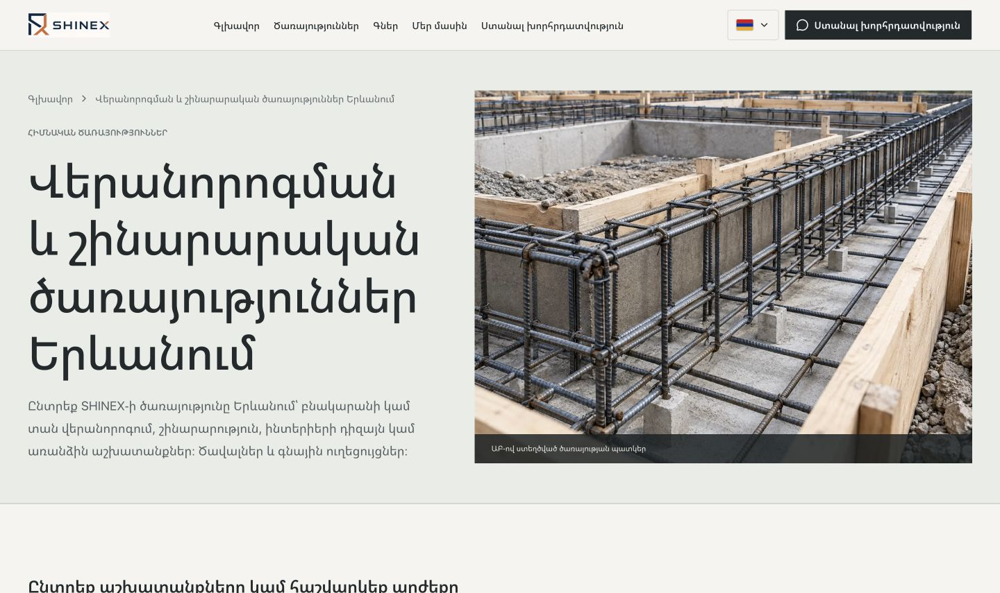
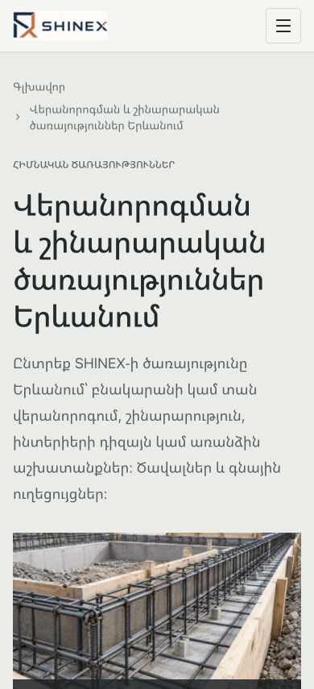

# Hero images — 10 November 2026

- Home: a new illustrative three-story residential building, generated with the built-in imagegen tool and saved as `public/images/home/residential-construction-hero.webp` (1536 × 1024, WebP, 270454 bytes).
- Services catalog: existing `public/images/services/monolithic-work-details.webp`, now displayed through the optional image slot in PageHero.
- Both images have localized alt text and visible AI illustration captions. Existing page titles, descriptions, metadata, routes, and links are preserved.
- Generation source retained at `/Users/shavarshpapoian/.codex/generated_images/01a1c23f-abbd-7af2-a872-a9b4725aba2d/exec-ace5512e-7083-4b6a-a782-dd6a291a7dfa.png`.

## Verification

- `npm run build`, `npm run lint`, `npm run typecheck`, `npm run seo:check`, formatting and scoped `git diff --check` passed.
- Production SEO snapshot: 120 pages, zero differences in protected SEO fields, original text blocks or internal link destinations.
- Browser: both images loaded at 1440 px; responsive checks at 320, 390, 768 and 960 px; services checked in all five locales. No horizontal overflow or browser console errors. See `hero-image-checks.json`.







## Final generation prompt

```text
Use case: photorealistic-natural
Asset type: premium construction and engineering company's website hero photograph, landscape 3:2 composition, also crops to nearly square.
Primary request: A substantial contemporary THREE-STORY low-rise residential building under construction, halfway between a townhouse ensemble and a small apartment building. Exactly ground floor plus two upper floors; this is not a skyscraper or a single cottage.
Scene: an organized building site in the dry, rocky outskirts of Yerevan, Armenia, quiet distant hills. The building is the dominant subject, seen from a three-quarter angle, entirely visible with comfortable margins around its roof and base. Strong reinforced-concrete frame, broad floor slabs, large window openings, terraces and recessed balconies, some installed graphite window frames and partially finished warm pale stone facade. Architecture feels structurally plausible, confident, substantial and refined. The structural shell is largely complete but sections remain visibly unfinished, clearly communicating construction competence. Simple flat roof, no wooden pitched roof.
Style: realistic architectural editorial photography, natural material imperfections, fine concrete and stone texture, straight verticals, restrained cinematic polish, realistic proportions.
Lighting: clear soft morning daylight, subtle warm sunlight, natural steel gray and warm stone colors, legible shadows, pale sky.
Composition: one coherent building centered; keep key architecture inside the central 80% for responsive cropping, view slightly above street level, not an aerial drone view; modest foreground construction area with neatly stacked masonry materials. No surrounding tall buildings.
Constraints: no text, no logos, no watermark, no people, no cars, no advertising, no luxury-villa pool, no dramatic cranes, no futuristic architecture. This is an illustrative architectural image, not a documented completed company project.
```
