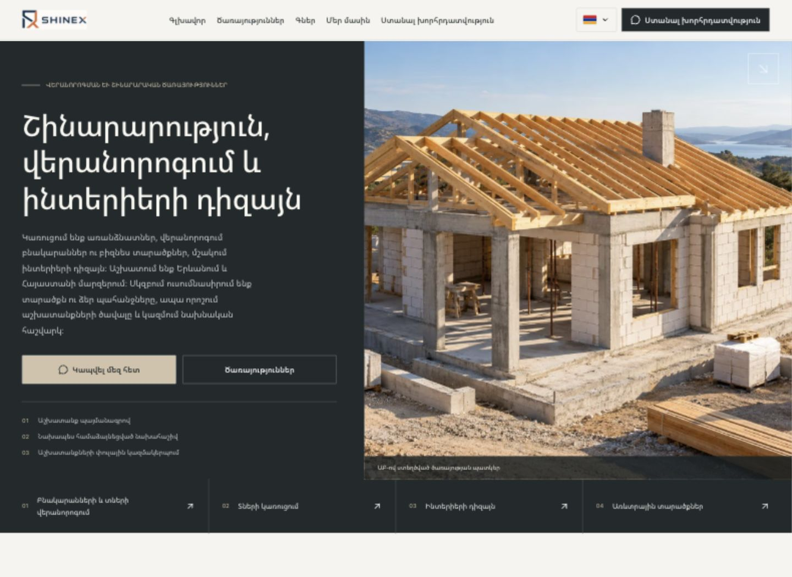
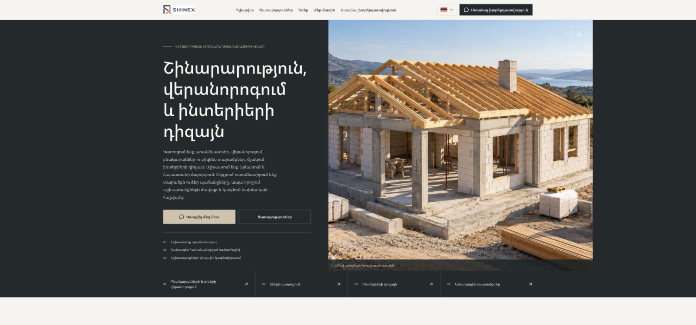
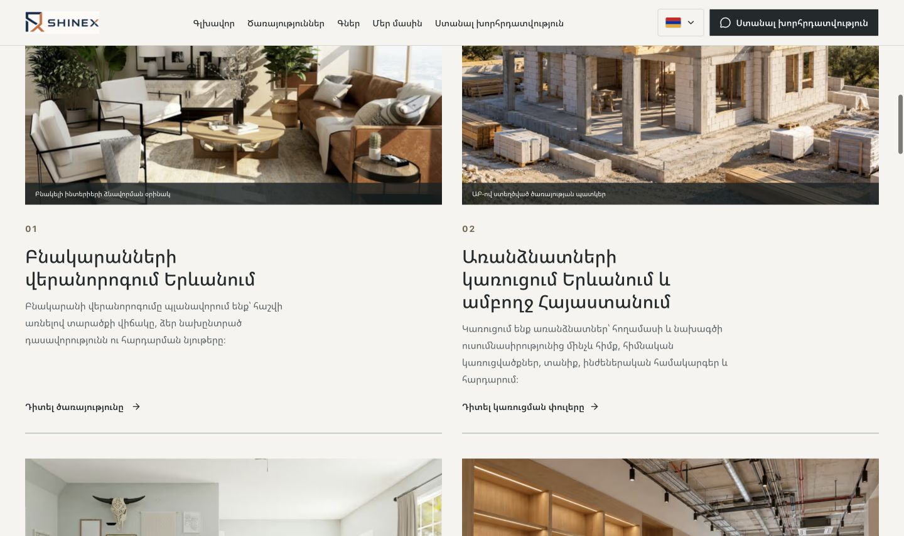
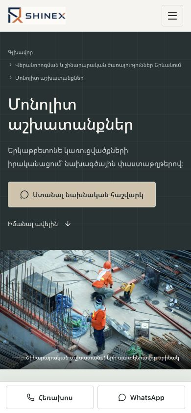

# SHINEX — визуальный редизайн

Дата: 10 ноября 2026. Работа выполнена в существующем Next.js 16.2.11 / React 19 проекте. Изменения сохранены локально; публикация shinex.am не выполнялась.

Последующее уточнение: на главной установлен новый трёхэтажный жилой объект; в каталоге услуг добавлен Hero с изображением. Детали, актуальные скриншоты, файл изображения, промпт и повторные проверки: [обновление Hero](HERO_IMAGES.md).

## Результат

- Единая система графита, стали, нейтральных поверхностей и приглушённых металлических акцентов. Общие токены цвета, радиусов, отступов, кнопок, карточек и заголовков.
- Полноширинная главная: строительный Hero, четыре ссылки на направления, крупные изображения квартир, строительства, интерьеров и коммерческих работ, технические изображения специализированных услуг.
- Удалено подключение анимированного строительного фона и клиентской обёртки SiteMotion из корневого layout. Контент остаётся серверным HTML.
- Все 16 услуг используют общие компоненты с четырьмя визуальными вариантами: инженерия, архитектура, интерьеры и коммерческие объекты. На каждой странице есть состав работ, этапы, контроль качества, связанные ссылки и CTA. Недостающие схемы этапов и блок качества собраны из уже существующих переводов.
- Каталог, цены, расчёт сметы, калькулятор, контакты, «О компании», политика конфиденциальности и формы используют общие поверхности и типографику. Бизнес-логика расчётов и заявок сохранена.
- Для армянского текста скорректированы межбуквенный интервал, высота строк и масштаб заголовков; подключение внешних шрифтов не добавлено.
- Исправлено выравнивание мобильного языкового меню: ранее оно выходило за левую границу экрана. На 320 px ссылки футера перестроены в одну колонку.
- Использованы существующие изображения с сохранением обозначений иллюстраций и ИИ-материалов. Кейсы, отзывы, сотрудники, лицензии и достижения не добавлялись. Для замены на подтверждённые фотографии предусмотрен существующий тип ServicePhoto и конфигурация service-media: источник, локализованный alt и подпись.

## Продолжение после прерывания

При возобновлении проверены Git diff, сохранённые SEO-снимки и браузерный журнал. Главная, все 16 услуг, общие компоненты и мобильная адаптация уже были реализованы. Эти изменения сохранены.

Завершена проверка широких экранов и устранены два оставшихся дефекта адаптивной типографики:

- На ширине 2560 px отступ Hero рассчитывался от окна, хотя сетка ограничена 1800 px. Текстовая колонка сжималась до 164 px. Расчёт теперь учитывает фактическую максимальную ширину сетки; колонка составляет 544 px. Максимальный размер армянского H1 уточнён, чтобы запятая оставалась вместе со словом.
- Общее правило заголовков секций перекрывало межстрочный интервал армянского текста. Добавлено адресное правило `:lang(hy)`, сохраняющее интервал 1.25.

Атрибут `sizes` главного изображения также ограничен фактическими 972 px на широком десктопе, чтобы браузер не выбирал излишне большой вариант. Новые библиотеки и клиентский JavaScript не добавлены.

## SEO: до и после

Первый production-build и HTTP-обход выполнены до изменений интерфейса. Снимки содержат фактический prerendered HTML всех 120 индексируемых URL в hy, ru, en, de и fr.

[Сравнение SEO](seo-comparison.json): **120 страниц, 0 расхождений**.

Сохранены:

- маршруты и список URL в sitemap;
- title, description, текст и количество H1;
- canonical, hreflang, язык HTML и robots;
- JSON-LD, включая Organization, WebSite, Service/WebPage и BreadcrumbList;
- все ранее существовавшие назначения внутренних ссылок;
- ранее существовавшие абзацы, H2/H3 и вопросы FAQ в серверном HTML;
- хеши исходных файлов переводов, SEO-конфигурации, metadata, sitemap, robots и proxy.

Добавлены только навигационные ссылки и повторно использованы существующие информационные тексты для новых презентационных блоков. Для полного исходного/конечного состояния: [до](seo-before.json), [после](seo-after.json), [HTTP до](http-before.json), [HTTP после](http-after.json).

HTTP-проверка прошла для всех 120 страниц, 50 вариантов прежних URL, корневого перенаправления, пяти перенаправлений trailing slash и 30 ожидаемых 404. Проверены внутренние якоря, серверный контент, hreflang, schema и share image. Неопубликованные blog/projects остались в прежнем состоянии; новые фиктивные проекты не публиковались.

Повторное сравнение после будущей сборки: `node scripts/redesign-seo-snapshot.mjs after`. Исходный снимок `before` не следует перезаписывать при проверке этого редизайна.

## Проверки

| Проверка | Результат |
| --- | --- |
| `npm run build` | Успешно, финальные изменения собраны; 138 статических результатов Next.js |
| `npm run lint` | Успешно, повторно после продолжения работы |
| `npm run typecheck` | Успешно; TypeScript дополнительно выполнен в финальном build |
| `npm run seo:check` | Успешно |
| SEO HTTP crawl | Успешно, все 120 индексируемых страниц |
| `npm run calculator:check` | Успешно, 6 сценариев и 5 языков |
| `npm run leads:check` | Успешно, Telegram заменён mock, реальные сообщения не отправлялись |
| `npm run analytics:check` | Успешно |
| `node scripts/motion-check.mjs` | Успешно для сохранённых утилит |
| `git diff --check` | Успешно |

Браузер: 47 уникальных сочетаний страницы и ширины (320, 390, 768, 960, 1280, 1440, 1920 и 2560 px), включая главную на пяти языках, все 16 армянских услуг, каталог, цены, контакты, калькулятор, about и privacy. В последних проверках нет переполнения и везде один H1. Проверены мобильное меню, сохранение пути при смене языка на телефоне и компьютере, открытие/закрытие контактов и FAQ, загрузка формы заявки и закрытие диалога клавишей Escape. Ошибок в консоли браузера не обнаружено. [Журнал](browser-checks.json) сохраняет также найденные и устранённые проблемы 320 и 2560 px. Главная на 2560 px дополнительно проверена на всех пяти языках; загрузка главного изображения подтверждена перед итоговым скриншотом.

## Производительность и ограничения

Общий объём несжатого prerendered HTML для 120 страниц уменьшился примерно на 36% (22 488 039 → 14 491 045 байт). На армянской главной снижение около 24%. Главный визуал главной теперь локальный WebP с eager/high-priority загрузкой; остальные изображения используют Next Image, sizes, фиксированную геометрию и lazy loading. Анимационный клиентский фон больше не подключается.

Это измерение объёма HTML, а не полевые Core Web Vitals. Lighthouse и реальные LCP/CLS на production-домене в этой задаче не измерялись; их нужно проверить после публикации. Часть существующих изображений услуг продолжает загружаться через Unsplash и Next Image, поэтому зависит от внешнего источника. Армянский шрифт использует системный fallback, возможны небольшие различия между ОС. Оригинальные фотографии SHINEX следует добавлять только после подтверждения их происхождения.

Изменения пользователя в `eslint.config.mjs`, `tsconfig.json` и `sites/` сохранены. Деплой, коммит и отправка изменений в удалённый репозиторий не выполнялись.

## Изменённые файлы

- [`app/[locale]/about/page.tsx`](../../app/[locale]/about/page.tsx)
- [`app/[locale]/calculator/page.tsx`](../../app/[locale]/calculator/page.tsx)
- [`app/[locale]/layout.tsx`](../../app/[locale]/layout.tsx)
- [`app/[locale]/services/page.tsx`](../../app/[locale]/services/page.tsx)
- [`app/globals.css`](../../app/globals.css)
- [`components/calculator/calculator-dialog.tsx`](../../components/calculator/calculator-dialog.tsx)
- [`components/calculator/construction-estimate-dialog.tsx`](../../components/calculator/construction-estimate-dialog.tsx)
- [`components/calculator/estimate-loading-state.tsx`](../../components/calculator/estimate-loading-state.tsx)
- [`components/calculator/renovation-contact.tsx`](../../components/calculator/renovation-contact.tsx)
- [`components/calculator/steps/construction-extras-step.tsx`](../../components/calculator/steps/construction-extras-step.tsx)
- [`components/calculator/steps/parameters-step.tsx`](../../components/calculator/steps/parameters-step.tsx)
- [`components/calculator/steps/renovation-extras-step.tsx`](../../components/calculator/steps/renovation-extras-step.tsx)
- [`components/calculator/steps/scenario-step.tsx`](../../components/calculator/steps/scenario-step.tsx)
- [`components/calculator/steps/wall-works-step.tsx`](../../components/calculator/steps/wall-works-step.tsx)
- [`components/forms/contact-dialog.tsx`](../../components/forms/contact-dialog.tsx)
- [`components/layout/footer.tsx`](../../components/layout/footer.tsx)
- [`components/layout/header.tsx`](../../components/layout/header.tsx)
- [`components/layout/language-switcher.tsx`](../../components/layout/language-switcher.tsx)
- [`components/layout/mobile-nav.tsx`](../../components/layout/mobile-nav.tsx)
- [`components/layout/premium-layout.css`](../../components/layout/premium-layout.css)
- [`components/sections/estimate-section.tsx`](../../components/sections/estimate-section.tsx)
- [`components/sections/hero.tsx`](../../components/sections/hero.tsx)
- [`components/sections/services-section.tsx`](../../components/sections/services-section.tsx)
- [`components/sections/specialized-services.tsx`](../../components/sections/specialized-services.tsx)
- [`components/seo/seo-landing-page.tsx`](../../components/seo/seo-landing-page.tsx)
- [`components/services/base-service-page.tsx`](../../components/services/base-service-page.tsx)
- [`components/services/service-landing-content.tsx`](../../components/services/service-landing-content.tsx)
- [`components/services/service-page.module.css`](../../components/services/service-page.module.css)
- [`components/services/service-page.tsx`](../../components/services/service-page.tsx)
- [`components/ui/button-styles.ts`](../../components/ui/button-styles.ts)
- [`components/ui/page-hero.tsx`](../../components/ui/page-hero.tsx)
- [`components/ui/section-heading.tsx`](../../components/ui/section-heading.tsx)
- [`components/ui/service-card.tsx`](../../components/ui/service-card.tsx)
- [`config/service-visuals.ts`](../../config/service-visuals.ts)
- [`scripts/redesign-seo-snapshot.mjs`](../../scripts/redesign-seo-snapshot.mjs)

Добавлены также снимки, HTTP-отчёты, браузерный журнал и этот отчёт в `docs/redesign/`.

## Скриншоты

