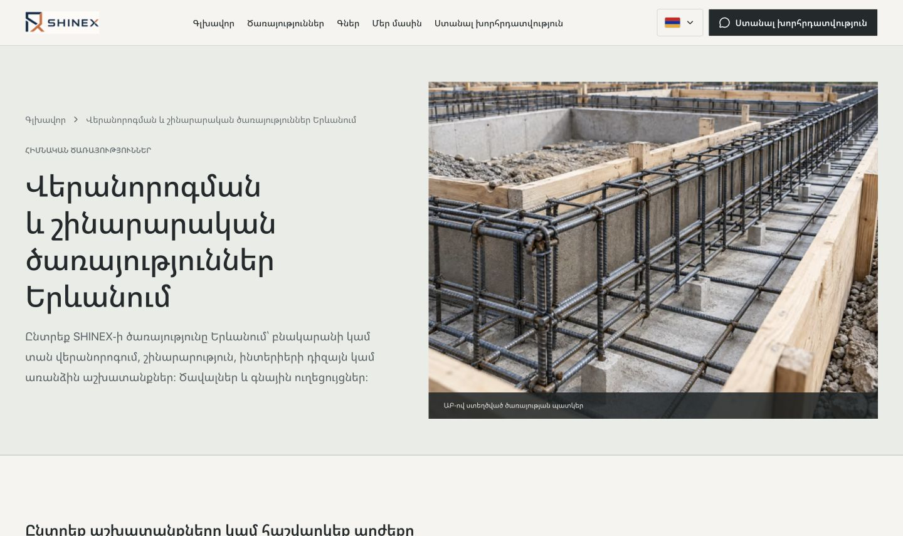
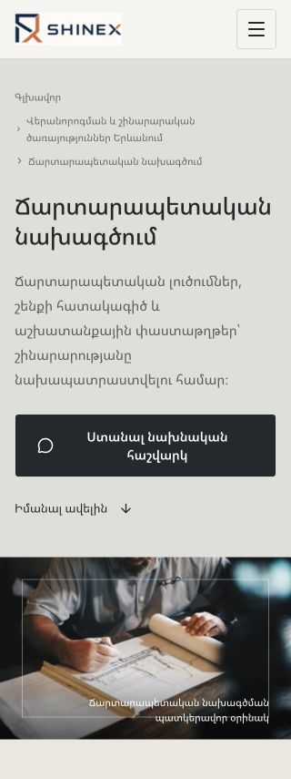

# Типографика SHINEX — 10 ноября 2026

Исправлено оформление текста без изменения формулировок, переводов и SEO.

## Что исправлено

- В Hero каталога заголовок зависел от ширины окна и достигал 72 px при текстовой колонке около 580 px. Армянское «և» оставалось отдельно, а «ծառայություններ» разрывалось перед последней буквой. Теперь размер зависит от ширины текстового блока: около 47 px в этом варианте. Заголовок сохраняет целые слова и равномерные строки.
- Такой же принцип применён к Hero услуг. Убраны конфликтующие размеры на отдельных брейкпоинтах. Скорректированы минимальные размеры заголовков секций и армянских заголовков карточек каталога.
- Для абзацев, списков, FAQ и ячеек таблиц включена аккуратная балансировка последних строк (`text-wrap: pretty`). Это устранило короткие окончания и отдельно стоящие знаки вопроса в нескольких локализациях.
- Пример сметы больше не сжимает три столбца до разрывов слов по буквам. Таблица сохраняет читаемую ширину и прокручивается внутри своего блока. Область имеет локализованное доступное название и поддерживает прокрутку клавиатурой; подтверждён сдвиг на 40 px после ArrowRight без переполнения страницы.
- Новые зависимости, шрифты и клиентский JavaScript не добавлены.

## Проверки

- 120 индексируемых страниц, все пять локализаций.
- Ширины 320, 390, 768, 1024, 1440 и 1920 px: всего 720 браузерных проверок production-сборки.
- По фактической геометрии строк проверены заголовки, абзацы, вопросы FAQ, подписи кнопок, списки, хлебные крошки, подписи полей, таблицы и ссылки футера. Отдельные числовые обозначения шагов не считаются ошибкой. Допустимые языковые переносы с дефисами отделены от произвольного разрыва слова.
- В проверенных элементах не обнаружены разрывы слов без переносов, отдельные короткие строки или переполнение страницы. Консоль браузера без ошибок. Визуально просмотрены основной проблемный Hero и длинный армянский заголовок на 320 px.
- `npm run build`, `npm run lint`, `npm run typecheck`, `npm run seo:check`, Prettier и `git diff --check` прошли.
- Сравнение production HTML с исходным SEO-снимком: 120 страниц, 0 расхождений. Тексты, H1, metadata, canonical, hreflang, schema, URL и прежние внутренние ссылки сохранены.

Данные: [до](typography-before.json), [после](typography-after.json), [проверка клавиатуры](typography-table-keyboard.json), [SEO](seo-comparison.json). Проверка до изменений охватывала основные текстовые элементы; таблицы и списки включены в расширенную итоговую проверку. Результаты относятся к указанным размерам и браузеру проверки.

## Изменённые исходные файлы

- `components/layout/premium-layout.css`
- `components/services/service-page.module.css`
- `components/seo/renovation-budget.tsx`

